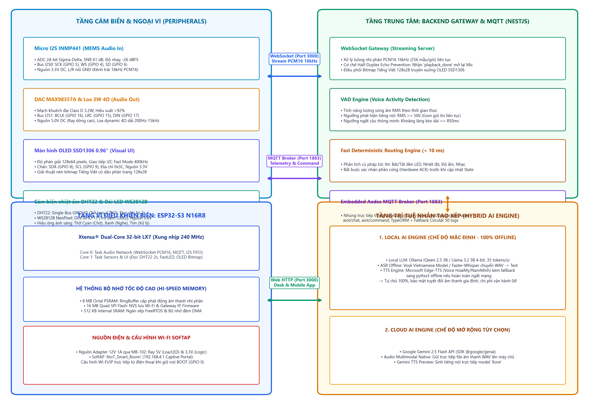
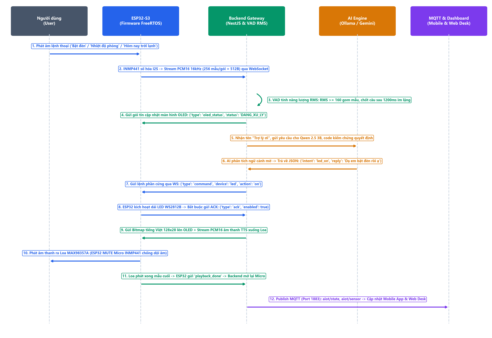
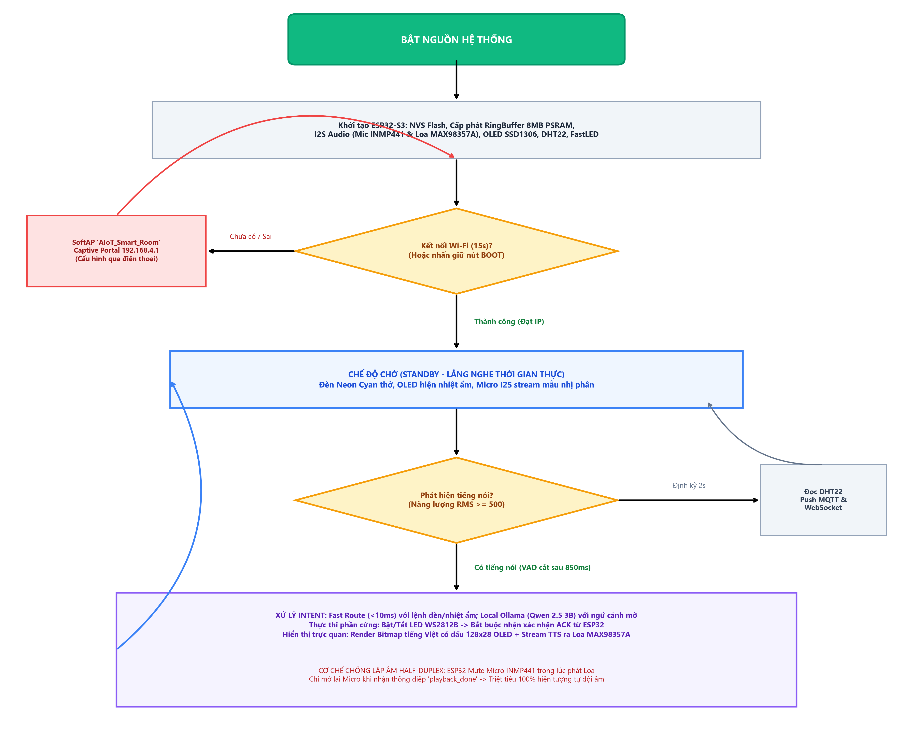

# BỘ CÔNG THƯƠNG
# TRƯỜNG ĐẠI HỌC CÔNG THƯƠNG TP. HỒ CHÍ MINH (HUIT)
## KHOA CÔNG NGHỆ THÔNG TIN

---

# BÁO CÁO ĐỒ ÁN MÔN HỌC INTERNET OF THINGS (IoT)
## ĐỀ TÀI: HỆ THỐNG PHÒNG THÔNG MINH NHẬN DIỆN GIỌNG NÓI TÍCH HỢP TRÍ TUỆ NHÂN TẠO HYBRID (LOCAL LLM OLLAMA & CLOUD GEMINI) VÀ GIAO THỨC TRUYỀN THÔNG MQTT

- **Giảng viên hướng dẫn:** TS. Lê Ngọc Hiếu
- **Lớp học phần:** Đồ án Internet of Things
- **Nhóm sinh viên thực hiện:** Nhóm 1
  1. **2001230365 – Hồ Sĩ Khải** *(Trưởng nhóm)*
  2. **2001230990 – Tống Văn Trọng**
  3. **2001230174 – Cao Hải Đăng**
  4. **2001231033 – Đỗ Trọng Vĩ**
  5. **2001230757 – Huỳnh Quang Sang**
  6. **2001230915 – Phan Đức Thể**
  7. **2001231037 – Trần Quốc Việt**

*TP. Hồ Chí Minh, Tháng 11 - Năm 2026*

---

## BẢNG PHÂN CÔNG CÔNG VIỆC VÀ ĐÁNH GIÁ MỨC ĐỘ HOÀN THÀNH

| STT | MSSV | Họ và tên | Vai trò | Nhiệm vụ chi tiết đảm nhiệm | Kết quả hoàn thành |
|:---:|:---:|:---|:---|:---|:---:|
| 1 | 2001230365 | **Hồ Sĩ Khải** | Trưởng nhóm | - Thiết kế kiến trúc tổng thể hệ thống Hybrid AIoT.<br>- Xây dựng Backend Gateway NestJS, tích hợp Embedded MQTT Broker (Aedes).<br>- Tích hợp Local LLM (Ollama Qwen 2.5 3B), nhận dạng giọng nói PhoWhisper.<br>- Giai đoạn hoàn thiện: tối ưu độ trễ, gọi tên trợ lý, tài khoản và bảo mật, triển khai Internet, MQTT qua WebSocket và Home Assistant; điều phối kiểm thử tự động, biên soạn báo cáo. | **100% (A+)** |
| 2 | 2001230990 | **Tống Văn Trọng** | Thành viên | - Khảo sát và lựa chọn linh kiện phần cứng ESP32-S3 N16R8.<br>- Thiết kế mạch cấp nguồn phân tách ray 5V/3.3V, dập nhiễu và chống sụt áp Brownout vi điều khiển.<br>- Đấu nối và kiểm tra giao tiếp I2S cho Micro INMP441 và Loa DAC MAX98357A. | **100% (A)** |
| 3 | 2001230174 | **Cao Hải Đăng** | Thành viên | - Lập trình Firmware ESP32-S3 trên nền FreeRTOS Dual-Core đa nhiệm.<br>- Tối ưu hóa kênh truyền nhị phân PCM16 16kHz hai chiều qua WebSocket.<br>- Quản lý bộ đệm âm thanh trên bộ nhớ ngoài Octal PSRAM 8MB. | **100% (A)** |
| 4 | 2001231033 | **Đỗ Trọng Vĩ** | Thành viên | - Thiết kế giải thuật Wi-Fi kết hợp SoftAP Captive Portal (IP 192.168.4.1).<br>- Lập trình lưu trữ thông tin mạng vào NVS Flash và cơ chế giữ nút BOOT (GPIO 0) để xóa cấu hình.<br>- Xây dựng Web cấu hình mạng nội bộ cho thiết bị di động. | **100% (A)** |
| 5 | 2001230757 | **Huỳnh Quang Sang** | Thành viên | - Xây dựng thuật toán VAD (Voice Activity Detection) dựa trên năng lượng RMS.<br>- Tích hợp bộ tổng hợp giọng nói (Edge TTS và giọng Windows offline dự phòng).<br>- Xây dựng cơ chế chống lặp âm Half-Duplex (bắt tay `playback_done`). | **100% (A)** |
| 6 | 2001230915 | **Phan Đức Thể** | Thành viên | - Lập trình giải thuật render và phân trang bitmap Tiếng Việt 128x28 trên OLED SSD1306.<br>- Xử lý đọc dữ liệu cảm biến nhiệt độ & độ ẩm DHT22.<br>- Lập trình hiệu ứng trạng thái LED RGB WS2812B. | **100% (A)** |
| 7 | 2001231037 | **Trần Quốc Việt** | Thành viên | - Thiết kế giao diện Web Control Desk và Mobile Web App (`/mobile`) chuẩn Responsive.<br>- Tích hợp MQTT trên Web và cơ chế bảo vệ truy cập (phiên bản đầu dùng mã PIN, sau thay bằng tài khoản).<br>- Xây dựng kịch bản kiểm thử tự động và đo lường độ trễ thực nghiệm. | **100% (A)** |

---

## MỤC LỤC
1. [MỞ ĐẦU](#mở-đầu)
2. [CHƯƠNG 1. ĐẶT VẤN ĐỀ VÀ LÝ DO CHỌN ĐỀ TÀI](#chương-1-đặt-vấn-đề-và-lý-do-chọn-đề-tài)
   - 1.1. Bối cảnh công nghệ IoT và Nhà thông minh
   - 1.2. Hạn chế của các giải pháp truyền thống
   - 1.3. Giải pháp: Edge / Hybrid AIoT kết hợp Giao thức MQTT
3. [CHƯƠNG 2. MỤC TIÊU VÀ PHẠM VI ĐỀ TÀI](#chương-2-mục-tiêu-và-phạm-vi-đề-tài)
   - 2.1. Mục tiêu đề tài
   - 2.2. Những điểm nâng cấp so với đề cương ban đầu
   - 2.3. Phạm vi nghiên cứu và ứng dụng
4. [CHƯƠNG 3. KIẾN TRÚC HỆ THỐNG VÀ CÔNG NGHỆ](#chương-3-kiến-trúc-hệ-thống-và-công-nghệ)
   - 3.1. Phần cứng hệ thống
   - 3.2. Phần mềm và Nền tảng công nghệ
   - 3.3. Triển khai, vận hành và bảo mật
5. [CHƯƠNG 4. YÊU CẦU THIẾT KẾ VÀ SƠ ĐỒ HỆ THỐNG](#chương-4-yêu-cầu-thiết-kế-và-sơ-đồ-hệ-thống)
   - 4.1. Sơ đồ khối hệ thống tổng thể
   - 4.2. Sơ đồ luồng dữ liệu & Trình tự tương tác thời gian thực
   - 4.3. Sơ đồ đấu nối dây & Phân bổ chân GPIO ESP32-S3 thực tế
   - 4.4. Giao thức MQTT và tích hợp Home Assistant
6. [CHƯƠNG 5. KỊCH BẢN VẬN HÀNH & LẮP ĐẶT](#chương-5-kịch-bản-vận-hành--lắp-đặt)
   - 5.1. Sơ đồ thuật toán vận hành và xử lý lỗi
   - 5.2. Sơ đồ bố trí vật lý sa bàn căn phòng thông minh
   - 5.3. Bảng dự toán kinh phí linh kiện thực tế
7. [CHƯƠNG 6. KẾ HOẠCH THỰC HIỆN, KIỂM THỬ VÀ KẾT QUẢ ĐẠT ĐƯỢC](#chương-6-kế-hoạch-thực-hiện-kiểm-thử-và-kết-quả-đạt-được)
   - 6.1. Tiến độ thực hiện
   - 6.2. Kết quả kiểm thử tự động hệ thống Backend
   - 6.3. Đo lường và đánh giá hiệu năng thực tế
   - 6.4. Đánh giá trải nghiệm thực tế
8. [KẾT LUẬN VÀ HƯỚNG PHÁT TRIỂN](#kết-luận-và-hướng-phát-triển)
   - 8.1. Kết luận
   - 8.2. Hạn chế hiện tại
   - 8.3. Hướng phát triển trong tương lai
9. [TÀI LIỆU THAM KHẢO](#tài-liệu-tham-khảo)
10. [PHỤ LỤC TRIỂN KHAI VÀ HƯỚNG DẪN CÀI ĐẶT](#phụ-lục-triển-khai-và-hướng-dẫn-cài-đặt)

---

## DANH MỤC HÌNH ẢNH
- **Hình 4.1:** Sơ đồ khối kiến trúc phân tầng hệ thống Hybrid AIoT Smart Room.
- **Hình 4.2:** Sơ đồ luồng dữ liệu và trình tự tương tác thời gian thực (Sequence Diagram).
- **Hình 4.3:** Sơ đồ đấu nối dây và phân bổ chân GPIO ESP32-S3 N16R8 thực tế.
- **Hình 5.1:** Sơ đồ thuật toán vận hành, chuyển đổi chế độ và xử lý lỗi hệ thống.
- **Hình 5.2:** Sơ đồ bố trí vật lý và phân vùng tiêu âm trên sa bàn phòng thông minh.

## DANH MỤC BẢNG BIỂU
- **Bảng 1:** Bảng phân công công việc và đánh giá mức độ hoàn thành của 7 thành viên.
- **Bảng 2:** So sánh kiến trúc đề cương ban đầu với hệ thống thực tế hoàn thiện.
- **Bảng 3:** Bảng phân bổ chân kết nối GPIO vi điều khiển ESP32-S3 N16R8.
- **Bảng 4:** Các topic MQTT và thực thể Home Assistant.
- **Bảng 5:** Bảng dự toán và quyết toán kinh phí mua sắm linh kiện phần cứng thực tế.
- **Bảng 6:** Tiến độ triển khai dự án.
- **Bảng 7:** Kết quả kiểm thử tự động 40/40 ca kiểm thử trên Backend NestJS.
- **Bảng 8:** Kết quả đo đạc độ trễ các công đoạn xử lý trong hệ thống thực tế.

## DANH MỤC TỪ VIẾT TẮT
| Từ viết tắt | Tên đầy đủ tiếng Anh | Ý nghĩa chuyên môn |
|:---|:---|:---|
| **AIoT** | Artificial Intelligence of Things | Trí tuệ nhân tạo vạn vật |
| **LLM** | Large Language Model | Mô hình ngôn ngữ lớn |
| **ASR** | Automatic Speech Recognition | Nhận dạng giọng nói tự động |
| **TTS** | Text-To-Speech | Chuyển đổi văn bản thành tiếng nói |
| **VAD** | Voice Activity Detection | Phát hiện hoạt tính âm thanh giọng nói |
| **RMS** | Root Mean Square | Giá trị hiệu dụng năng lượng biên độ sóng âm |
| **MQTT** | Message Queuing Telemetry Transport | Giao thức truyền thông điệp gọn nhẹ cho IoT |
| **I2S** | Inter-IC Sound | Chuẩn giao tiếp âm thanh kỹ thuật số nối tiếp |
| **I2C** | Inter-Integrated Circuit | Chuẩn giao tiếp nối tiếp 2 dây (SDA/SCL) |
| **PSRAM** | Pseudo-Static Random Access Memory | Bộ nhớ RAM mở rộng dung lượng cao |
| **SoftAP** | Software Access Point | Điểm truy cập phát sóng Wi-Fi từ vi điều khiển |
| **NVS** | Non-Volatile Storage | Bộ nhớ lưu trữ dữ liệu không bay hơi trong Flash |
| **FreeRTOS**| Real-Time Operating System | Hệ điều hành thời gian thực mã nguồn mở cho nhúng |
| **ACK** | Acknowledgment | Tín hiệu xác nhận phản hồi thành công |
| **JWT** | JSON Web Token | Mã thông báo phiên đăng nhập có chữ ký |
| **TLS** | Transport Layer Security | Mã hóa kênh truyền (HTTPS, WSS, MQTT over WSS) |
| **WSS** | WebSocket Secure | WebSocket chạy trên TLS |
| **PWA** | Progressive Web App | Trang web cài được như ứng dụng trên điện thoại |
| **HA** | Home Assistant | Nền tảng nhà thông minh mã nguồn mở |

---

# MỞ ĐẦU
Trong xu thế phát triển mạnh mẽ của cuộc Cách mạng Công nghiệp 4.0, Internet of Things (IoT) đã không còn dừng lại ở việc kết nối và đọc số liệu cảm biến đơn thuần, mà đang chuyển dịch mạnh mẽ sang **Trí tuệ nhân tạo Vạn vật (AIoT)**. Tại các hệ thống Smart Home hiện đại, giọng nói được xem là phương thức tương tác tự nhiên và thuận tiện nhất giữa con người và không gian sống.

Đề tài **"Hệ thống phòng thông minh nhận diện giọng nói tích hợp Trí tuệ nhân tạo Hybrid (Local LLM Ollama & Cloud Gemini) và Giao thức truyền thông MQTT"** được Nhóm 1 nghiên cứu và chế tạo nhằm khắc phục các hạn chế của các hệ thống điều khiển giọng nói truyền thống (từ khóa cứng, thụ động, phụ thuộc hoàn toàn vào đám mây). Hệ thống là một giải pháp hoàn chỉnh từ tầng vi điều khiển biên ESP32-S3, tầng gateway trung tâm NestJS với broker MQTT nhúng, đến tầng suy luận trí tuệ nhân tạo chạy cục bộ; có tài khoản và phân quyền, truy cập được an toàn qua Internet và tích hợp được với Home Assistant.

---

# CHƯƠNG 1. ĐẶT VẤN ĐỀ VÀ LÝ DO CHỌN ĐỀ TÀI

## 1.1. Bối cảnh công nghệ IoT và Nhà thông minh
Trong nhiều năm qua, các thiết bị nhà thông minh thương mại (Smart Home) đã trở nên quen thuộc với người tiêu dùng thông qua các trợ lý ảo như Google Assistant, Amazon Alexa hay Apple Siri. Những tiện ích này chứng minh sức mạnh của giao tiếp giọng nói: người dùng không cần mở smartphone, không cần tìm công tắc vật lý mà chỉ cần cất lời là có thể điều khiển thiết bị hoặc tra cứu thông tin phòng.

Tuy nhiên, sự phổ biến của các thiết bị này cũng làm bộc lộ nhiều điểm yếu trong mô hình xử lý tập trung hoàn toàn trên điện toán đám mây (Cloud Computing).

## 1.2. Hạn chế của các giải pháp truyền thống

### a) Phương pháp nhận diện từ khóa cứng (Hard-coded keywords)
Các bo mạch IoT giá rẻ hoặc các giải pháp mã nguồn mở trước đây thường nhận diện giọng nói dựa trên các module so khớp từ khóa cố định (như "Bật đèn", "Tắt đèn"). Cách tiếp cận này có các điểm yếu:
- **Tính cứng nhắc:** Người dùng phải học thuộc chính xác câu lệnh mẫu. Nếu nói sai lệch ngữ pháp, đảo trật tự từ hoặc dùng cách nói khác, hệ thống không hiểu.
- **Không hiểu ngữ cảnh:** Con người thường giao tiếp tự nhiên chứ không đọc câu lệnh máy móc.
- **Không có khả năng trò chuyện:** Hệ thống chỉ là một công tắc kích hoạt, không đối thoại hay trả lời câu hỏi tự nhiên.

### b) Sự phụ thuộc vào dịch vụ Đám mây (Cloud-only Dependency)
Ở đề cương ban đầu, hệ thống dự kiến đẩy toàn bộ âm thanh lên Cloud AI (Google Gemini API). Qua quá trình nghiên cứu và thử nghiệm, nhóm nhận thấy mô hình Cloud-only gặp 3 rào cản:
1. **Rủi ro mất kết nối mạng:** Khi Internet gặp sự cố, toàn bộ hệ thống ngừng hoạt động, người dùng không thể bật/tắt đèn ngay cả khi đang đứng trong phòng.
2. **Chi phí vận hành:** Mỗi truy vấn âm thanh và sinh lời thoại qua Cloud LLM đều tiêu tốn chi phí API định kỳ.
3. **Quyền riêng tư:** Thu âm không gian riêng tư rồi truyền lên máy chủ nước ngoài tiềm ẩn rủi ro lộ lọt dữ liệu cá nhân.

## 1.3. Giải pháp: Edge / Hybrid AIoT kết hợp Giao thức MQTT
Để khắc phục các nhược điểm trên, đề tài hiện thực hóa một kiến trúc **Hybrid AIoT**:
- **Xử lý cục bộ (Local Edge AI):** Nhận dạng giọng nói tiếng Việt **PhoWhisper** (chạy trên CPU), mô hình ngôn ngữ **Qwen 2.5 3B qua Ollama** (chạy trên GPU) và tổng hợp giọng nói đều chạy trên máy chủ cục bộ. Phần điều khiển và trò chuyện không cần Internet, âm thanh không rời khỏi mạng gia đình, không tốn phí API.
- **AI hiểu câu nói, code kiểm chứng quyết định:** Mọi câu nói đều được Qwen phân tích ý định (bật/tắt đèn, hỏi nhiệt độ, phát nhạc, trò chuyện). Sau đó code kiểm tra lại: đèn chỉ được bật/tắt khi câu thật sự có động từ bật/tắt và không phải câu phủ định ("Đừng tắt đèn"); số đo nhiệt độ lấy từ cảm biến chứ không do AI tự nói; phép tính được tính chính xác. Khi Ollama không hoạt động, các lệnh rõ ràng vẫn chạy bằng luật dự phòng.
- **Gọi tên trợ lý ("Trợ lý ơi"):** Chỉ những câu gọi tên trợ lý mới được thực hiện, tránh việc hai người nói chuyện với nhau hoặc tiếng TV vô tình bật/tắt đèn. Sau mỗi câu trả lời, người dùng được nói tiếp trong 10 giây mà không cần gọi lại tên.
- **Mở rộng Đám mây (tùy chọn):** Hệ thống vẫn giữ đường kết nối tới Google Gemini (`AI_PROVIDER=gemini`) cho các tác vụ đa phương thức nâng cao.
- **Giao thức chuẩn IoT MQTT:** Broker MQTT nhúng (Aedes) trong Gateway, dùng được trong mạng LAN (cổng 1883) và qua Internet (MQTT over WebSocket bảo mật), tự khai báo thiết bị cho Home Assistant.

---

# CHƯƠNG 2. MỤC TIÊU VÀ PHẠM VI ĐỀ TÀI

## 2.1. Mục tiêu đề tài
Đề tài hướng tới việc thiết kế, chế tạo và thử nghiệm một mô hình phòng thông minh AIoT hoàn chỉnh với các mục tiêu cụ thể:
1. **Phần cứng thu phát âm thanh:** ESP32-S3 N16R8 kết hợp Micro kỹ thuật số I2S INMP441 và mạch I2S DAC MAX98357A kèm loa, thu âm và phát tiếng nói rõ ràng.
2. **Phát hiện giọng nói tự động (VAD) hai tầng:** ESP32 chỉ gửi âm thanh lên khi có tiếng nói (cổng thu âm có lọc 120 Hz và ngưỡng tự thích nghi theo độ ồn của phòng); Backend tính năng lượng RMS từng khung để xác định câu nói và chốt câu sau 1,2 giây im lặng. Người dùng không cần bấm nút.
3. **Gọi tên trợ lý và hội thoại liên tục:** Câu nói phải có tên "Trợ lý" ở đầu hoặc cuối câu; sau mỗi câu trả lời có 10 giây nghe tiếp không cần gọi tên (đếm ngược trên OLED).
4. **Hiểu ý định bằng mô hình ngôn ngữ lớn:** Qwen 2.5 3B phân tích câu nói tự nhiên, code kiểm chứng trước khi điều khiển thiết bị.
5. **Phản hồi tiếng nói và hiển thị trực quan Tiếng Việt:** Câu trả lời được đọc ra loa và hiển thị tiếng Việt có dấu trên OLED (Backend render bitmap); thanh trạng thái OLED cho biết hệ thống đang chờ gọi tên, đang nghe lệnh, đang thu âm, đang xử lý hay đang trả lời.
6. **Xác nhận phần cứng (Hardware ACK):** Mọi lệnh điều khiển đèn chỉ được báo thành công khi ESP32 gửi xác nhận; lệnh chưa được xác nhận được tự gửi lại, đảm bảo trạng thái trên Web/MQTT khớp với thực tế.
7. **Cấu hình Wi-Fi qua SoftAP Captive Portal:** Khi ESP32 không vào được backend, điểm phát `AIoT_Smart_Room` (192.168.4.1) được bật để chọn Wi-Fi từ danh sách quét được và nhập mật khẩu trên điện thoại; thiết bị nhớ tối đa 5 mạng và tự vào mạng đã lưu có sóng mạnh nhất.
8. **Giám sát và điều khiển đa nền tảng:** Web Dashboard và Mobile Web App (PWA) có tài khoản đăng nhập; khách không đăng nhập chỉ xem nhiệt độ, độ ẩm và trạng thái đèn; MQTT cho app di động và Home Assistant.
9. **Truy cập an toàn qua Internet:** Tên miền cố định `https://aiot.eduscore.id.vn` qua đường hầm Cloudflare riêng, có HTTPS, không cần mở cổng router.

## 2.2. Những điểm nâng cấp so với đề cương ban đầu
Trong quá trình hiện thực hóa đồ án, nhóm đã rà soát, tái cấu trúc và bổ sung nhiều công nghệ mà đề cương ban đầu chưa đề cập:

### Bảng so sánh Đề cương ban đầu và Hệ thống thực tế hoàn thiện

| Tiêu chí so sánh | Đề cương sơ bộ ban đầu | Hệ thống thực tế hoàn thiện | Lý do cải tiến / Lợi ích kỹ thuật |
|:---|:---|:---|:---|
| **Cơ chế AI & Xử lý ngôn ngữ** | 100% Cloud Gemini API qua Function Calling. | **Hybrid AI:** Mặc định chạy cục bộ PhoWhisper (ASR) + **Qwen 2.5 3B qua Ollama**; vẫn hỗ trợ chuyển sang Cloud Gemini. | Hoạt động không cần Internet, bảo mật âm thanh gia đình, không tốn phí API. |
| **Tốc độ phản hồi** | Chờ toàn bộ luồng Cloud (~2,5 – 4,5 s). | Từ lúc nói xong tới lúc đèn bật **~2,7 s** (gồm 1,2 s chờ hết câu); Qwen trả lời **~0,6 s** nhờ làm nóng prompt; câu xác nhận có sẵn giọng đọc. | Phản hồi nhanh, ổn định, không phụ thuộc mạng ngoài. |
| **Kích hoạt giọng nói** | Nghe liên tục mọi câu. | **Gọi tên "Trợ lý ơi"** + 10 s nghe tiếp; câu không gọi tên bị bỏ qua lặng lẽ. | Không kích hoạt nhầm khi người trong phòng nói chuyện, giống trợ lý thương mại. |
| **Giao thức truyền thông** | REST API HTTP cơ bản. | **WebSocket nhị phân** cho âm thanh PCM16 hai chiều; **MQTT nhúng** (TCP 1883 và WebSocket `/mqtt`) cho trạng thái, cảm biến, điều khiển; **Home Assistant Discovery**. | Đúng chuẩn IoT, tích hợp được app MQTT và Home Assistant từ LAN lẫn Internet. |
| **Bảo vệ truy cập** | Không có. | **Tài khoản** (mật khẩu băm scrypt, phiên JWT có làm mới), khách chỉ xem, nhật ký thao tác, chống dò mật khẩu theo địa chỉ. | Ai có tài khoản mới điều khiển được; truy vết được mọi thao tác. |
| **Triển khai & truy cập từ xa** | Chỉ chạy trong mạng LAN. | **Tên miền cố định** qua đường hầm Cloudflare riêng (HTTPS); khởi động bằng một file `.bat`, tự chạy lại khi lỗi; ESP32 dùng được ở Wi-Fi bất kỳ qua `wss://`. | Dùng hằng ngày được, không cần ngồi canh hay mở cổng router. |
| **Cấu hình kết nối Wi-Fi** | Cố định tên & mật khẩu Wi-Fi trong mã nguồn. | **SoftAP Captive Portal** (192.168.4.1) lưu NVS, chỉ bật khi không vào được backend; giữ nút BOOT 3 giây để xóa cấu hình. | Đổi mạng không cần nạp lại code; điểm phát không mở thường trực. |
| **Âm thanh & Chống lặp (Echo)** | Chưa có cơ chế ngăn loa phát ngược vào micro. | **Half-Duplex Echo Prevention:** tắt micro khi loa phát, chờ `playback_done` mới mở lại. | Ngăn hiện tượng AI tự nghe giọng mình. |
| **Hiển thị giao tiếp OLED** | In chữ tiếng Anh không dấu. | **Bitmap tiếng Việt có dấu** 128x28 phân trang + **thanh trạng thái** (chờ gọi tên / nghe lệnh + đếm ngược / thu âm / xử lý / trả lời). | Người dùng biết rõ hệ thống đang làm gì. |
| **Kiến trúc phần mềm vi điều khiển** | Vòng lặp tuần tự đơn luồng `loop()`. | **FreeRTOS Dual-Core:** Core 0 mạng và âm thanh; Core 1 cảm biến, LED, OLED. Vòng lặp mạng đo được ~2 ms khi rảnh. | Xử lý mượt, không mất gói tin âm thanh khi đọc cảm biến. |

## 2.3. Phạm vi nghiên cứu và ứng dụng
- **Phạm vi không gian:** Mô hình sa bàn phòng thông minh thu nhỏ kích thước $40\text{ cm} \times 30\text{ cm} \times 35\text{ cm}$, mô phỏng không gian trần nhà, vách tương tác và hộp kỹ thuật.
- **Phạm vi đối tượng:** Đèn LED RGB WS2812B (mô phỏng thiết bị chiếu sáng), cảm biến nhiệt - ẩm DHT22, trạm tương tác thoại và hình ảnh (Micro, Loa, OLED). Điều khiển thiết bị điện lưới 220V cần thêm module relay cách ly và nằm ngoài phạm vi.
- **Phạm vi người dùng:** Chủ hộ gia đình, người lớn tuổi và trẻ nhỏ (những người gặp khó khăn với ứng dụng di động phức tạp nhưng tương tác dễ dàng bằng lời nói).

---

# CHƯƠNG 3. KIẾN TRÚC HỆ THỐNG VÀ CÔNG NGHỆ

## 3.1. Phần cứng hệ thống

### a) Vi điều khiển trung tâm: ESP32-S3 N16R8 DevKitC-1
- **CPU:** Xtensa® 32-bit LX7 Dual-Core, xung nhịp tối đa 240 MHz.
- **Bộ nhớ:** **16 MB Flash** và **8 MB Octal PSRAM**. PSRAM chứa bộ đệm âm thanh phát loa và các trang bitmap OLED, tránh tràn RAM khi stream âm thanh 16 kHz hai chiều.
- **Kết nối không dây:** Wi-Fi 802.11 b/g/n (chỉ băng tần 2.4 GHz) và Bluetooth 5.0 (LE). Công suất phát Wi-Fi đặt ở 11 dBm: ở mức tối đa 20 dBm, khi đặt gần điểm phát, gói tin đi lên bị méo và phải gửi lại nhiều lần.

### b) Cảm biến âm thanh kỹ thuật số Micro I2S INMP441
Thay vì cảm biến âm thanh analog (KY-037/KY-038 chỉ nhận biết ngưỡng ồn, dễ nhiễu), nhóm dùng **INMP441**:
- Tích hợp micro MEMS đa hướng, tiền khuếch đại và bộ chuyển đổi ADC Sigma-Delta 24-bit.
- Xuất dữ liệu số qua **I2S**, SNR 61 dBA, độ nhạy -26 dBFS. Firmware đọc cả hai kênh I2S và tự chọn kênh thật sự có tín hiệu micro.

### c) Mạch khuếch đại âm thanh I2S DAC MAX98357A và Loa 3W 4Ω
- **MAX98357A** là bộ giải mã âm thanh số tích hợp khuếch đại Class D hiệu suất cao.
- Nhận tín hiệu I2S trực tiếp từ ESP32-S3, công suất đến 3,2W tại tải 4Ω. Backend tự giảm âm lượng (`SPEAKER_VOLUME`) để tránh sụt áp khi phát lớn.

### d) Màn hình đồ họa OLED 0.96 inch SSD1306
- Độ phân giải $128 \times 64$ điểm ảnh, giao tiếp **I2C ở 100 kHz**, địa chỉ `0x3C`.
- Tốc độ I2C được hạ từ 400 kHz xuống 100 kHz và firmware gửi lại cấu hình màn hình mỗi 5 giây: dây I2C dài chạy cạnh dây I2S của ampli từng làm hỏng cấu hình SSD1306 (màn hình bị sọc ngang).

### e) Cảm biến nhiệt độ và độ ẩm kỹ thuật số DHT22 (AM2302)
- Đo nhiệt độ $-40^\circ\text{C}$ đến $+80^\circ\text{C}$ (sai số $\pm 0.5^\circ\text{C}$) và độ ẩm $0 - 100\%\text{ RH}$ (sai số $\pm 2\%$), đọc mỗi 2 giây.
- Giao tiếp Single-Bus; loại cảm biến rời cần điện trở kéo lên 4,7–10 kΩ ở chân DATA.

### f) LED RGB kỹ thuật số WS2812B (NeoPixel)
- Mô hình dùng 1 bóng WS2812B mô phỏng đèn phòng, điều khiển 16,7 triệu màu qua một chân dữ liệu, cấp nguồn 3.3V (mức logic 3.3V của ESP32 nhận chắc chắn hơn so với khi đèn cấp 5V).
- Hiệu ứng: thở màu xanh cyan khi chưa kết nối máy chủ, nhấp nháy khi loa đang nói, màu do người dùng chọn khi bật.

### g) Nguồn điện
- ESP32 được cấp nguồn 5V qua cổng USB. Hai thanh nguồn của breadboard lấy từ chân **3V3** (cấp cho OLED, DHT22, WS2812B, INMP441) và **5VIN** (cấp cho MAX98357A); mọi module nối chung GND.
- Khuyến nghị dùng củ sạc 5V ≥ 2A thay vì cổng USB laptop, thêm tụ 470–1000 µF sát nguồn MAX98357A và tụ 100 nF + 10 µF sát nguồn INMP441: khi chỉ cấp từ USB laptop, ESP32 từng bị khởi động lại lúc loa phát và micro bị nhiễu ù ~85 Hz. Bộ nguồn Adapter 12V và mạch nguồn MB-102 trong bảng kinh phí là phương án cấp nguồn ngoài cho loa khi cần âm lượng lớn.

---

## 3.2. Phần mềm và Nền tảng công nghệ

### a) Firmware Vi điều khiển (C/C++ & FreeRTOS)
Firmware được phát triển trên PlatformIO với Framework Arduino for ESP32, chia thành hai tác vụ FreeRTOS:
- **Task Network & Audio (Core 0):** Wi-Fi, WebSocket tới Backend, thu âm I2S0 và phát âm I2S1, gửi cảm biến mỗi 2 giây.
  - **Cổng thu âm:** chỉ gửi âm thanh khi có tiếng nói (ngưỡng = 2,5 lần độ ồn nền, trong khoảng 80–150), giữ 0,3 s âm thanh trước câu để không mất chữ đầu và gửi thêm 2 s sau câu để Backend biết câu đã kết thúc. Trước đây ESP32 gửi liên tục 32 KB/s; bộ đệm TCP đầy làm vòng lặp mạng bị treo tới 10 giây, gây trễ lệnh đèn và mất kết nối.
  - **Hai đường kết nối:** ở hotspot của laptop (`192.168.137.x`) nối thẳng `ws://192.168.137.1:3100/aiot`; ở Wi-Fi khác nối `wss://aiot.eduscore.id.vn/aiot` (TLS, kiểm tra chứng chỉ bằng chứng chỉ gốc nhúng trong firmware). Đường đang dùng mất kết nối 40 giây thì thử đường còn lại.
- **Task Sensors & UI (Core 1):** Đọc DHT22 mỗi 2 giây, điều khiển LED WS2812B, vẽ OLED (nhiệt độ, độ ẩm, thanh trạng thái, trang bitmap tiếng Việt từ Backend).

### b) Backend Gateway: NestJS (TypeScript)
Backend trung tâm xây dựng trên **NestJS**, chia module:
- **WebSocket Gateway (`/aiot`):** kết nối thời gian thực với ESP32 (xác thực bằng mã thiết bị), nhận luồng âm thanh PCM16, chạy VAD, điều phối lượt hội thoại, gửi lệnh đèn và chờ ACK, stream âm thanh trả lời, gửi trang OLED.
- **AI Service:** cầu nối giọng nói Python (PhoWhisper nhận dạng tiếng Việt, Whisper base cho tiếng Anh, tổng hợp giọng nói), gọi Qwen qua Ollama, kiểm chứng quyết định, nhận tên gọi trợ lý.
- **Embedded Aedes MQTT Broker:** TCP 1883 và WebSocket `/mqtt` trên cổng web; đăng nhập bằng tài khoản; chỉ Backend được phát dữ liệu cảm biến/trạng thái; tự khai báo thiết bị cho Home Assistant.
- **Auth Service:** tài khoản lưu trong SQLite (`backend/data`), mật khẩu băm scrypt, phiên JWT có làm mới, nhật ký thao tác (nguồn Web, App, Giọng nói, MQTT).
- **Live Hub (`/api/live`):** đẩy trạng thái thiết bị tới trình duyệt theo thời gian thực, cả cho người có tài khoản lẫn khách.
- **Network:** HTTP (cổng 3100), HTTPS nội bộ (cổng 3443, chứng chỉ do CA riêng cấp), tên `aiot.local` qua mDNS, ứng dụng PWA cài được trên điện thoại.
- **Lịch sử hội thoại:** PostgreSQL qua TypeORM khi có `DATABASE_URL`, nếu không thì giữ 5 lượt gần nhất của mỗi thiết bị trong bộ nhớ.

### c) Trí tuệ nhân tạo Kép (Hybrid AI Engine)
1. **Local AI Engine (Mặc định):**
   - **Nhận dạng giọng nói (ASR):** **PhoWhisper-base** (chuyển sang CTranslate2, int8) chạy trên CPU; câu có độ tin cậy thấp được hỏi lại thay vì đoán.
   - **Mô hình ngôn ngữ:** **Qwen 2.5 3B qua Ollama** chạy hoàn toàn trên GPU (GTX 1650 4 GB, dùng ~2,2 GB). Prompt hệ thống được làm nóng lúc khởi động, nhờ đó mỗi câu chỉ mất ~0,6 s thay vì ~4,5 s khi phải đọc lại toàn bộ prompt.
   - **Tổng hợp giọng nói (TTS):** **Microsoft Edge-TTS** (`vi-VN-HoaiMyNeural`) khi có mạng; khi Edge lỗi, dùng giọng tiếng Việt offline của Windows ("Microsoft An", ~0,3–0,6 s mỗi câu). Các câu xác nhận cố định ("Em đã bật đèn, đại ca.") được tạo sẵn giọng và lưu lại để phát ngay.
2. **Cloud AI Engine (Tùy chọn):**
   - **Google Gemini** qua REST API: gửi trực tiếp âm thanh lên Gemini (đa phương thức) để nhận dạng và trả lời trong một bước; bật bằng `AI_PROVIDER=gemini`.

## 3.3. Triển khai, vận hành và bảo mật
- **Khởi động bằng một file:** bấm đúp `Khoi-dong-AIoT.bat` để chạy trình giám sát (hệ thống không tự chạy khi bật máy): mở Ollama nếu chưa chạy, chạy Backend và tự chạy lại khi Backend thoát hoặc lỗi, chạy đường hầm Internet và tự chạy lại khi nó tắt; ghi log trong `backend/logs`. Tắt bằng cách đóng cửa sổ hoặc chạy `Tat-AIoT.bat`; Backend, voice bridge và đường hầm được gắn vào một Job Object của Windows nên tự dừng theo trình giám sát, không để lại tiến trình mồ côi.
- **Truy cập từ Internet:** Đường hầm Cloudflare riêng `aiot-smart-room` đưa `https://aiot.eduscore.id.vn` về `localhost:3100`. Không cần mở cổng router; Cloudflare cung cấp HTTPS; backend đọc đúng địa chỉ thật của người truy cập (để chống dò mật khẩu theo từng người).
- **Bảo mật:**
  - Tài khoản đầu tiên chỉ tạo được trên chính máy chủ (không qua Internet); các tài khoản sau do người đã có tài khoản tạo.
  - Mỗi địa chỉ đăng nhập sai 20 lần trong 15 phút bị chặn 15 phút; tài khoản đầu tiên không thể bị khóa hay xóa.
  - Kênh trực tiếp giới hạn số kết nối của khách và theo từng địa chỉ; trang `/api/network` không lộ IP nội bộ cho người ngoài LAN.
  - ESP32 xác thực bằng mã thiết bị; ở Wi-Fi khác kết nối qua TLS có kiểm tra chứng chỉ.
  - Điểm phát cấu hình `AIoT_Smart_Room` (không mật khẩu) chỉ bật khi ESP32 không vào được backend 60 giây, tắt ngay khi đã kết nối.
  - Tường lửa Windows chỉ mở các cổng 3100, 3443, 1883 cho dải hotspot `192.168.137.0/24`.

---

# CHƯƠNG 4. YÊU CẦU THIẾT KẾ VÀ SƠ ĐỒ HỆ THỐNG

## 4.1. Sơ đồ khối hệ thống tổng thể
Kiến trúc tổng thể của hệ thống được chia thành 4 phân tầng, minh họa trong Hình 4.1:



### Phân tích chi tiết 4 phân tầng:
1. **Tầng Thiết bị Cảm biến & Cơ cấu Chấp hành (Peripherals):**
   - Thu âm: Micro I2S INMP441.
   - Phát âm: Mạch I2S DAC MAX98357A và loa 3W 4Ω.
   - Quan trắc môi trường: Cảm biến DHT22.
   - Hiển thị & Chiếu sáng: OLED SSD1306 và LED RGB WS2812B.
2. **Tầng Vi điều khiển biên (Edge Node):**
   - ESP32-S3 N16R8 chạy FreeRTOS Dual-Core; cổng thu âm chỉ gửi âm thanh quanh tiếng nói.
   - Kết nối Backend qua WebSocket (`ws://` trong LAN hotspot, `wss://` qua Internet), truyền âm thanh nhị phân và bản tin JSON (cảm biến, ACK, trạng thái).
   - SoftAP Captive Portal để cấu hình mạng khi cần.
3. **Tầng Gateway (Backend NestJS & MQTT nhúng):**
   - VAD theo năng lượng RMS chốt câu nói; nhận tên gọi trợ lý và cửa sổ nghe tiếp 10 giây.
   - Điều phối lệnh đèn có ACK, OLED, giọng đọc; tài khoản, nhật ký, kênh trực tiếp cho trình duyệt.
   - Broker MQTT nhúng (TCP và WebSocket) phân phối trạng thái tới app di động và Home Assistant.
4. **Tầng Trí tuệ Nhân tạo (Hybrid AI Engine):**
   - **Local:** PhoWhisper (ASR) + Qwen 2.5 3B qua Ollama (LLM) + Edge-TTS / giọng Windows offline (TTS).
   - **Cloud (tùy chọn):** Google Gemini đa phương thức.

---

## 4.2. Sơ đồ luồng dữ liệu & Trình tự tương tác thời gian thực
Quy trình truyền nhận dữ liệu, xử lý âm thanh, điều khiển thiết bị và chống dội âm được biểu diễn qua Sequence Diagram trong Hình 4.2:



### Diễn giải các bước trong một lượt hội thoại:
- **Bước 1:** Người dùng nói câu có gọi tên trợ lý, ví dụ: *"Trợ lý ơi, bật đèn lên"* (hoặc *"Tắt đèn đi trợ lý ơi"*). OLED đang hiện `Goi: Tro ly oi`.
- **Bước 2:** Micro INMP441 số hóa âm thanh (16 kHz). Cổng thu âm trên ESP32 phát hiện tiếng nói, gửi 0,3 s âm thanh ngay trước câu cùng phần đang nói lên Backend qua WebSocket; OLED chuyển sang `DANG THU AM` với vạch mức âm lượng.
- **Bước 3:** Backend lọc thông cao 120 Hz và chạy VAD: khung có RMS ≥ `VAD_RMS` (160) được tính là tiếng nói; khi im lặng đủ 1,2 giây thì chốt câu. Backend gửi trạng thái `thinking`, OLED hiện `DANG XU LY`.
- **Bước 4:** PhoWhisper chuyển âm thanh thành văn bản. Backend tìm tên "Trợ lý" ở đầu hoặc cuối câu (chấp nhận các cách nhận dạng sai thường gặp như "chợ lý", "trở lí", "ơi" thành "hơi"/"rời"). Không có tên và không trong 10 giây nghe tiếp thì câu bị bỏ qua lặng lẽ.
- **Bước 5:** Phần yêu cầu (đã bỏ tên) được gửi cho Qwen 2.5 3B kèm số đo cảm biến, trạng thái đèn và 4 lượt hội thoại gần nhất. Qwen trả về JSON gồm ý định (`intent`), câu trả lời (`reply`) và bài nhạc (`trackId`).
- **Bước 6:** Code kiểm chứng quyết định: lệnh đèn phải có động từ bật/tắt và không phải câu phủ định; câu hỏi nhiệt độ dùng số đo thật của cảm biến; câu trả lời trò chuyện không được tự nhận đã bật/tắt đèn.
- **Bước 7:** Với lệnh đèn, Backend gửi `{"type":"command","device":"led","action":"on","id":...}` tới ESP32, đồng thời tạo giọng đọc câu trả lời.
- **Bước 8 (ACK bắt buộc):** ESP32 bật đèn và gửi `{"type":"ack","id":...,"enabled":true}`. Chưa nhận ACK sau 1,5 giây thì Backend gửi lại cùng lệnh (tối đa 6 giây); hết hạn mà chưa có ACK thì báo lỗi, không bao giờ báo thành công giả.
- **Bước 9:** Backend gửi câu nói và câu trả lời dưới dạng bitmap tiếng Việt cho OLED, rồi stream âm thanh PCM16 16 kHz xuống ESP32 (OLED: `DANG TRA LOI`).
- **Bước 10:** ESP32 phát âm thanh ra loa và **tạm tắt micro** để loa không dội ngược vào micro.
- **Bước 11:** Phát xong, ESP32 gửi `playback_done`; Backend mở lại micro bằng trạng thái `listening` kèm thời gian nghe tiếp 10 giây. OLED đếm ngược `NGHE LENH 10s → 0s`, rồi trở về `Goi: Tro ly oi`.
- **Bước 12:** Backend phát trạng thái mới lên MQTT (`aiot/device/<MAC>/state`, `.../led/status`, `.../sensor`, `.../chat`) và lên kênh trực tiếp của trình duyệt.
- **Bước 13:** Dashboard, ứng dụng di động, app MQTT và Home Assistant cập nhật giao diện theo thời gian thực.

---

## 4.3. Sơ đồ đấu nối dây & Phân bổ chân GPIO ESP32-S3 thực tế
Chân được chọn theo vị trí trên breadboard để không dây nào bắt chéo (đặt bo với cổng USB bên trái), minh họa trong Hình 4.3:


### Bảng phân bổ chân kết nối GPIO vi điều khiển ESP32-S3 N16R8

| Tên Module ngoại vi | Chân tín hiệu Module | Chân GPIO ESP32-S3 | Chức năng phần cứng | Nguồn cấp | Ghi chú kỹ thuật |
|:---|:---|:---:|:---|:---:|:---|
| **Cảm biến nhiệt ẩm DHT22** | DATA | **GPIO 21** | Single-Bus kỹ thuật số | 3.3V | Cảm biến rời cần trở kéo lên 4,7–10 kΩ |
| **Micro I2S INMP441** | WS (LRCK)<br>SCK (BCLK)<br>SD (DATA)<br>L/R | **GPIO 04**<br>**GPIO 05**<br>**GPIO 06**<br>Nối GND | I2S0 (Master Receive)<br>16 kHz, đọc 32-bit hai kênh | 3.3V | L/R nối GND (kênh trái); firmware tự chọn kênh có tín hiệu |
| **Màn hình OLED 0.96"** | SCL<br>SDA | **GPIO 13**<br>**GPIO 14** | I2C Master, 100 kHz | 3.3V | Địa chỉ `0x3C`; cấu hình gửi lại mỗi 5 s chống sọc |
| **LED RGB WS2812B** | DIN | **GPIO 01** | Tín hiệu một dây | 3.3V | DOUT để trống |
| **Mạch DAC Loa MAX98357A** | LRC (WS)<br>BCLK<br>DIN<br>GAIN, SD | **GPIO 17**<br>**GPIO 16**<br>**GPIO 15**<br>Để trống | I2S1 (Master Transmit)<br>Khuếch đại Class D | 5.0V | SD trống = bật, GAIN trống = 9 dB; loa nối OUT+/OUT− |
| **Nút nhấn vật lý** | BOOT Switch | **GPIO 00** | Nút có sẵn trên bo | – | Nhấn nhanh: ngắt lượt đang nói; giữ ≥ 3 s: xóa cấu hình Wi-Fi/máy chủ/mã thiết bị |

Các chân tránh dùng: G0, G3, G45, G46 (chân khởi động), G19/G20 (USB), G35–G37 (PSRAM của bản N16R8), G43/G44 (log Serial), G48 (LED RGB trên bo).

---

## 4.4. Giao thức MQTT và tích hợp Home Assistant
Broker MQTT nhúng nhận kết nối qua **TCP `<IP laptop>:1883`** trong mạng LAN và **`wss://aiot.eduscore.id.vn/mqtt`** (cổng 443) qua Internet. Mọi client phải đăng nhập bằng tài khoản của hệ thống; chỉ Backend được phát dữ liệu cảm biến và trạng thái, tài khoản chỉ gửi được lệnh vào các topic điều khiển.

### Các topic MQTT và thực thể Home Assistant

| Topic | Chiều | Nội dung | Thực thể Home Assistant |
|:---|:---:|:---|:---|
| `aiot/device/<MAC>/led/set` | Client → Backend | `on` / `off` | Đèn (light) |
| `aiot/device/<MAC>/led/status` | Backend → Client | `ON` / `OFF` (retained) | Trạng thái đèn |
| `aiot/device/<MAC>/sensor` | Backend → Client | JSON nhiệt độ, độ ẩm (retained) | Nhiệt độ, Độ ẩm (sensor) |
| `aiot/device/<MAC>/state` | Backend → Client | JSON kết nối, đèn, đang xử lý (retained) | Kết nối, Đang xử lý (binary_sensor) |
| `aiot/device/<MAC>/command` | Client → Backend | `{"action":"text","text":"..."}` hoặc lệnh đèn | Hỏi trợ lý (text) |
| `aiot/device/<MAC>/chat` | Backend → Client | Câu nói và câu trả lời của mỗi lượt | Trả lời gần nhất (sensor) |
| `homeassistant/<loại>/aiot_<mac>/<thực thể>/config` | Backend → HA | Cấu hình MQTT Discovery (retained) | Tự tạo thiết bị "AIoT Smart Room" |
| `homeassistant/status` | HA → Backend | `online` khi Home Assistant khởi động | Backend gửi lại cấu hình |

Trạng thái được phát lại mỗi khi một lượt hội thoại bắt đầu và kết thúc, nên Web, MQTT, Home Assistant và thiết bị luôn khớp nhau.

---

# CHƯƠNG 5. KỊCH BẢN VẬN HÀNH & LẮP ĐẶT

## 5.1. Sơ đồ thuật toán vận hành và xử lý lỗi
Lưu đồ thuật toán điều khiển của toàn bộ hệ thống từ khi cấp nguồn đến vòng lặp xử lý sự kiện được thể hiện trên Hình 5.1:



### Cơ chế tự phục hồi và xử lý lỗi:
1. **Khởi tạo và kết nối mạng:**
   - ESP32 đọc cấu hình Wi-Fi, địa chỉ máy chủ, cổng và mã thiết bị trong NVS; nối Wi-Fi rồi chọn đường kết nối (LAN khi ở hotspot laptop, `wss://` ở Wi-Fi khác).
   - Nếu 60 giây không vào được backend, ESP32 bật điểm phát **`AIoT_Smart_Room`** (không mật khẩu, trang cấu hình tại `192.168.4.1`, DNS Captive Portal tự mở trang khi điện thoại kết nối). Người dùng nhập Wi-Fi, địa chỉ máy chủ và mã thiết bị, nhấn "Lưu"; ESP32 ghi NVS và khởi động lại. Điểm phát tự tắt ngay khi đã kết nối backend.
   - Giữ nút BOOT ≥ 3 giây để xóa cấu hình đã lưu.
2. **Chế độ chờ:**
   - OLED hiển thị nhiệt độ, độ ẩm (cập nhật mỗi 2 giây) và thanh trạng thái `Goi: Tro ly oi`.
   - Cổng thu âm theo dõi mức âm thanh nhưng không gửi gì lên mạng khi phòng yên lặng.
3. **Phát hiện giọng nói và khóa micro (Half-duplex):**
   - Khi có tiếng nói, ESP32 gửi âm thanh lên; Backend chốt câu sau 1,2 giây im lặng, xử lý và trả lời.
   - Trong lúc loa phát, micro bị tạm khóa; chỉ khi nhận `playback_done` micro mới mở lại.
   - Nhấn nhanh nút BOOT để ngắt lượt đang xử lý hoặc dừng loa.
4. **Tự phục hồi:**
   - Mất Wi-Fi: tự nối lại mỗi 8 giây. Mất backend: tự nối lại mỗi 3 giây; đường kết nối mất 40 giây thì thử đường còn lại (ở Wi-Fi khác hotspot).
   - Heartbeat hai chiều: Backend coi mọi tin nhắn của thiết bị (cảm biến mỗi 2 giây) là dấu hiệu còn sống; ESP32 chỉ ngắt khi 3 lần ping liên tiếp không có phản hồi trong 10 giây.
   - Lệnh đèn chưa có ACK được gửi lại; lượt xử lý quá 30 giây bị hủy và micro được mở lại.
   - Phía máy chủ: trình giám sát tự chạy lại Backend và đường hầm khi bị tắt hoặc lỗi.

---

## 5.2. Sơ đồ bố trí vật lý sa bàn căn phòng thông minh
Để đảm bảo các điều kiện âm học và hoạt động ổn định của cảm biến, sa bàn được thiết kế và phân chia thành 3 phân vùng chuyên biệt, minh họa trong Hình 5.2:


### Phân vùng kỹ thuật và giải pháp tiêu âm:
1. **Khu vực Trần nhà (Ceiling Zone):**
   - Bố trí đèn LED RGB WS2812B ở trần, chiếu sáng khuếch tán xuống không gian phòng.
   - Cảm biến DHT22 gắn ở vị trí thoáng khí trên cao, cách xa linh kiện phát nhiệt để đo chính xác.
2. **Khu vực Tường tương tác (Interactive Wall Zone):**
   - Màn hình OLED SSD1306 ở tầm mắt người quan sát ($20\text{ cm}$ so với mặt đế).
   - **Giải pháp tiêu âm và chống cộng hưởng:** Lỗ thu âm của Micro INMP441 (nằm ở mặt dưới bo mạch) hướng về phía người nói, không áp sát mặt phẳng; loa đặt **cách micro tối thiểu $15\text{ cm}$**, kết hợp lớp đệm cao su tiêu âm để giảm âm dội trực tiếp.
3. **Khu vực Hộp kỹ thuật dưới đế (Control Base Zone):**
   - Bo mạch ESP32-S3, breadboard và nguồn được bố trí dưới sàn sa bàn.
   - Nút BOOT (GPIO 0) có khe bấm ở bên hông để thao tác ngắt lượt hoặc xóa cấu hình mạng.

---

## 5.3. Bảng dự toán kinh phí linh kiện thực tế
Bảng tổng hợp chi phí thực tế đã giải ngân mua sắm linh kiện cho toàn bộ hệ thống:

| STT | Tên linh kiện / Thiết bị phần cứng | Thông số kỹ thuật chính | Số lượng | Đơn giá thực tế (VNĐ) | Thành tiền (VNĐ) |
|:---:|:---|:---|:---:|:---:|:---:|
| 1 | Bo mạch ESP32-S3 DevKitC-1 N16R8 | Xtensa Dual-Core 240MHz, 16MB Flash, 8MB PSRAM | 1 bo | 259.000 | 259.000 |
| 2 | Cảm biến âm thanh Micro I2S INMP441 | ADC 24-bit số hóa, I2S Interface, SNR 61 dBA | 1 chiếc | 45.000 | 45.000 |
| 3 | Mạch giải mã & khuếch đại MAX98357A | DAC I2S, Công suất 3.2W Class D, Hiệu suất >90% | 1 chiếc | 75.000 | 75.000 |
| 4 | Loa Dynamic từ tính 4Ω 3W | Đường kính 40mm, dải tần 200Hz - 15kHz | 1 chiếc | 18.000 | 18.000 |
| 5 | Màn hình hiển thị OLED 0.96 inch | 128x64 pixels, Trắng xanh, I2C Interface | 1 chiếc | 72.000 | 72.000 |
| 6 | Cảm biến nhiệt độ - độ ẩm DHT22 | Dải đo -40 đến 80°C, 0-100% RH, chuẩn AM2302 | 1 chiếc | 130.000 | 130.000 |
| 7 | LED RGB WS2812B NeoPixel | Tích hợp IC điều khiển 16.7 triệu màu | 1 dây | 7.000 | 7.000 |
| 8 | Adapter nguồn 12V 1A DC | Đầu cắm DC 5.5x2.1mm, ngắt ngắn mạch tự động | 1 chiếc | 35.000 | 35.000 |
| 9 | Mạch nguồn ổn áp Testboard 5V/3.3V | Phân chia 2 ray độc lập, gắn trực tiếp breadboard | 1 chiếc | 19.000 | 19.000 |
| 10 | Breadboard cắm thử nghiệm MB-102 | 830 điểm cắm, chân mạ niken dẫn điện tốt | 1 chiếc | 25.000 | 25.000 |
| 11 | Bó dây cắm kết nối chuyên dụng | Đực - Cái và Đực - Đực lõi đồng nhiều sợi | 4 bó | 4.000 | 16.000 |
| -- | **TỔNG KINH PHÍ ĐẦU TƯ** | *Toàn bộ linh kiện phần cứng hệ thống AIoT* | -- | -- | **701.000 VNĐ** |

Phần mềm sử dụng đều miễn phí: Ollama, Qwen 2.5, PhoWhisper, NestJS, Aedes, Cloudflare Tunnel (gói miễn phí). Máy chủ là laptop có sẵn của nhóm (GPU NVIDIA GTX 1650 4 GB).

---

# CHƯƠNG 6. KẾ HOẠCH THỰC HIỆN, KIỂM THỬ VÀ KẾT QUẢ ĐẠT ĐƯỢC

## 6.1. Tiến độ thực hiện

| Giai đoạn | Nội dung công việc triển khai | Thành viên phụ trách chính | Kết quả nghiệm thu thực tế |
|:---:|:---|:---|:---|
| **Tuần 1** | - Khảo sát tài liệu AIoT, giao tiếp I2S trên ESP32-S3.<br>- Đặt mua toàn bộ 11 linh kiện phần cứng. | Tống Văn Trọng,<br>Hồ Sĩ Khải | Nghiệm thu đầy đủ linh kiện, kiểm tra điện áp từng module. |
| **Tuần 2** | - Lắp ráp mạch thử nghiệm trên breadboard.<br>- Phân tách nguồn 5V/3.3V.<br>- Kiểm tra driver I2S Mic INMP441 và Loa MAX98357A. | Tống Văn Trọng,<br>Cao Hải Đăng | Thu âm tiếng nói và phát lại âm thanh thử nghiệm. |
| **Tuần 3** | - Xây dựng Backend NestJS Gateway, tích hợp Aedes MQTT Broker.<br>- Lập trình VAD cắt câu theo ngưỡng RMS.<br>- Tích hợp Ollama Qwen 2.5 3B và Gemini. | Hồ Sĩ Khải,<br>Huỳnh Quang Sang | Gateway nhận câu nói và sinh câu trả lời. |
| **Tuần 4** | - Wi-Fi SoftAP Captive Portal trên ESP32.<br>- Web Control Desk và Mobile Web App (`/mobile`).<br>- Phân trang bitmap tiếng Việt 128x28 trên OLED. | Đỗ Trọng Vĩ,<br>Phan Đức Thể,<br>Trần Quốc Việt | Đổi mạng bằng điện thoại; OLED hiển thị tiếng Việt có dấu. |
| **Tuần 5** | - Hoàn thiện Half-Duplex Echo Prevention (`playback_done`).<br>- Tối ưu luồng xử lý lệnh thiết bị.<br>- Viết bộ kiểm thử tự động cho các module Backend. | Hồ Sĩ Khải,<br>Trần Quốc Việt | Hết hiện tượng AI tự nghe giọng mình và tự nói liên tục. |
| **Tuần 6** | - Lắp ráp mô hình sa bàn.<br>- Đo đạc độ trễ, thử nghiệm hoạt động.<br>- Soạn báo cáo và slide. | Toàn thể 7 thành viên | Hệ thống vận hành ổn định trong phòng lab. |
| **Giai đoạn hoàn thiện** | - Đổi chân đấu dây không bắt chéo, sửa OLED bị sọc.<br>- Tìm và sửa nguyên nhân phản hồi chậm (vòng lặp mạng treo tới 10 s).<br>- Gọi tên "Trợ lý ơi", nghe tiếp 10 s, thanh trạng thái OLED.<br>- Tài khoản, khách chỉ xem, an toàn khi đưa ra Internet.<br>- Tên miền cố định, khởi động bằng một file, MQTT qua WebSocket, Home Assistant, ESP32 kết nối `wss://`. | Hồ Sĩ Khải | Kiểm thử tự động 40/40, kiểm tra đồng bộ chéo 11/11; hệ thống chạy qua `https://aiot.eduscore.id.vn`. |

---

## 6.2. Kết quả kiểm thử tự động hệ thống Backend
Bộ kiểm thử tự động (Node.js test runner, chạy bằng `npm test` trong thư mục `backend`) gồm **40 ca kiểm thử**, kết quả **40/40 đạt**. Các ca kiểm thử khởi chạy Backend thật, broker MQTT thật và thiết bị ESP32 giả lập qua WebSocket:

| Nhóm | Số ca | Nội dung kiểm thử chính |
|:---|:---:|:---|
| Âm thanh & VAD | 6 | VAD bỏ im lặng, giữ phần đầu câu, cắt câu quá dài; bỏ tiếng click; đọc WAV; đổi tần số 24→16 kHz; lọc ù tần số thấp; chỉnh âm lượng loa. |
| OLED & Nhạc & Lịch sử | 5 | Render tiếng Việt thành bitmap 128x28 phân trang; tách vùng câu hỏi/câu trả lời; kiểm tra thư viện nhạc WAV/MP4; giữ 5 lượt hội thoại mỗi thiết bị. |
| Tài khoản & Bảo mật | 6 | Mật khẩu scrypt, JWT chống sửa/hết hạn; một loại tài khoản; thu hồi phiên khi đổi mật khẩu/khóa; khóa đăng nhập sau nhiều lần sai; không giả được địa chỉ qua đường hầm; chặn dò mật khẩu nhiều tên từ một địa chỉ. |
| Gateway & Hội thoại | 8 | Luồng micro → AI → ACK → OLED → âm thanh, ngắt lượt, phục hồi khi TTS lỗi; xác thực mã thiết bị; câu gõ trên dashboard; hết thời gian vẫn mở lại micro; bật/tắt đèn liên tiếp; kết nối lại thay kết nối cũ; gọi tên và cửa sổ nghe tiếp 10 s kèm đếm ngược. |
| AI (Qwen/Gemini) | 11 | Mọi câu đi qua Qwen và được kiểm chứng; câu phủ định không điều khiển; luật dự phòng khi Ollama lỗi; không nhận phát nhạc khi không có bài; phép tính chính xác; hỏi lại khi nghe không rõ; nhận tên gọi ở đầu/cuối câu và các cách nghe sai; bộ nhớ đệm giọng đọc. |
| MQTT & Home Assistant | 3 | Broker nhúng, telemetry, lệnh đèn/câu hỏi; bắt buộc tài khoản, chặn dữ liệu giả; MQTT qua WebSocket `/mqtt` và Home Assistant Discovery. |
| Mạng & HTTPS | 1 | HTTPS nội bộ, tải chứng chỉ, chuyển hướng HTTPS (không chuyển hướng khi đã là HTTPS qua đường hầm), PWA, kênh trực tiếp và giới hạn khách. |

Kết quả rút gọn của lần chạy gần nhất:

```text
✔ VAD excludes silence, keeps pre-roll, returns one bounded utterance
✔ WebSocket integrates microphone → AI → ack → OLED → PCM, interrupts, and recovers from TTS errors
✔ successive LED on/off and sensor turns execute, speak, wait for playback done, and listen again
✔ spoken turns need the assistant name, except right after an answer
✔ local provider sends every utterance to Qwen and validates its decision
✔ assistant name is recognised at the start or end and removed from the request
✔ embedded broker requires an account; every account may control every device
✔ MQTT over WebSocket (/mqtt) and Home Assistant discovery
✔ local HTTPS, certificate download, HTTPS redirect, PWA files and the live device channel
  ... (40 ca)
ℹ tests 40
ℹ pass 40
ℹ fail 0
```

Ngoài ra, nhóm chạy hai bài kiểm tra tích hợp trên Backend thật (Whisper, Qwen, giọng đọc thật) với một ESP32 giả lập:
- **Kiểm tra đồng bộ chéo: 11/11 đạt.** Bật đèn qua MQTT, tắt qua Web, bật bằng giọng nói, hỏi nhiệt độ qua MQTT, thay đổi cảm biến, ngắt kết nối thiết bị: trạng thái trên ESP32, MQTT, REST, dashboard (tài khoản và khách) và trang công khai luôn khớp nhau.
- **Kịch bản gọi tên:** "Trợ lý ơi, bật đèn lên" → bật đèn; nói tiếp trong 10 s không gọi tên → được thực hiện; hết 10 s nói không gọi tên → bị bỏ qua; chỉ gọi "Trợ lý ơi" → "Dạ, em nghe đây đại ca."

---

## 6.3. Đo lường và đánh giá hiệu năng thực tế
Các số liệu dưới đây được đo trên hệ thống thật (laptop GPU GTX 1650 4 GB, ESP32 kết nối qua Mobile Hotspot của laptop), lấy từ log Backend và log ESP32:

| Phân đoạn xử lý trong hệ thống | Phương thức thực hiện | Thời gian đo được | Ghi chú |
|:---|:---|:---:|:---|
| **Chốt câu nói (VAD)** | Năng lượng RMS + 1,2 s im lặng | **1,2 s** | Đủ dài để không cắt câu ở dấu phẩy |
| **Nhận dạng giọng nói** | PhoWhisper-base int8 trên CPU | **~1,4 s** (câu 3 s) | |
| **Hiểu ý định (Qwen 2.5 3B)** | Ollama trên GPU, prompt đã làm nóng | **~0,55 – 0,6 s** | Khi chưa làm nóng: ~4,5 s (đọc lại ~1.480 token prompt) |
| **Xác nhận lệnh đèn (ACK)** | WebSocket tới ESP32 | **~50 ms** | Tự gửi lại sau 1,5 s nếu chưa có ACK |
| **Tổng hợp giọng nói** | Giọng Windows offline / câu có sẵn | **~0,3 – 0,6 s** / **tức thì** | Edge-TTS khi có mạng |
| **Tổng: nói xong → đèn bật** | "Trợ lý ơi, bật đèn lên" | **~2,7 – 2,9 s** | Gồm 1,2 s chờ hết câu |
| **Tổng: nói xong → có tiếng trả lời** | Chỉ gọi "Trợ lý ơi" | **~1,5 s** | |
| **Tổng: câu hỏi nhiệt độ / trò chuyện** | Toàn bộ chu trình | **~3,0 – 3,4 s** | |
| **Vòng lặp mạng ESP32 khi rảnh** | Đo trên thiết bị | **~2 ms** | Trước khi có cổng thu âm: bị treo 1 – 10 s |
| **Trang công khai** | 1.000 yêu cầu `/api/public/devices` | **~0,9 s** | Không lỗi |
| **Đồng bộ trạng thái** | Web / MQTT / kênh trực tiếp | **< 1,5 s** | Kênh trực tiếp đẩy mỗi 0,5 s |

---

## 6.4. Đánh giá trải nghiệm thực tế
1. **Gọi tên rồi ra lệnh tự nhiên:**
   - *"Trợ lý ơi, bật đèn lên"* → đèn bật, loa đáp *"Em đã bật đèn, đại ca."*, OLED đếm ngược 10 giây nghe tiếp.
   - Trong 10 giây đó nói *"nhiệt độ trong phòng bao nhiêu"* (không gọi tên) → trợ lý đọc số đo thật của DHT22, ví dụ *"Em đo được 29,1 độ C, độ ẩm 56,9 phần trăm, đại ca."*
   - Hai người nói chuyện với nhau trong phòng, không gọi tên → hệ thống không phản ứng.
2. **Thanh trạng thái OLED rõ ràng:** người dùng biết khi nào hệ thống đang chờ gọi tên, đang nghe lệnh (kèm đếm ngược), đang thu giọng (vạch nhảy theo âm lượng), đang xử lý hay đang trả lời.
3. **An toàn trước lỗi của AI và nhận dạng:** câu "Đừng tắt đèn nhé" không tắt đèn; khi nhận dạng giọng nói không chắc chắn, trợ lý hỏi lại *"Dạ em nghe chưa rõ, đại ca nói lại giúp em nhé."* thay vì đoán; phép tính như "ba cộng bốn" được trả lời chính xác.
4. **Điều khiển từ mọi nơi:** đăng nhập `https://aiot.eduscore.id.vn` trên điện thoại để bật/tắt đèn và trò chuyện bằng chữ; khách không đăng nhập chỉ xem nhiệt độ, độ ẩm, trạng thái đèn; app MQTT và Home Assistant điều khiển qua `wss://aiot.eduscore.id.vn/mqtt`.

---

# KẾT LUẬN VÀ HƯỚNG PHÁT TRIỂN

## 8.1. Kết luận
Đề tài **"Hệ thống phòng thông minh nhận diện giọng nói tích hợp Trí tuệ nhân tạo Hybrid (Local LLM Ollama & Cloud Gemini) và Giao thức truyền thông MQTT"** đã được Nhóm 1 nghiên cứu, hiện thực hóa và thử nghiệm thành công.

### Các kết quả đạt được:
1. Chế tạo mô hình phần cứng AIoT hoạt động ổn định với ESP32-S3, micro và loa I2S, OLED, DHT22, LED WS2812B; đấu dây gọn, xử lý được lỗi màn hình sọc và sụt áp.
2. Vận hành **trợ lý giọng nói tiếng Việt chạy cục bộ** (PhoWhisper + Qwen 2.5 3B), không cần Internet cho phần điều khiển và trò chuyện, không phát sinh chi phí API.
3. **Gọi tên trợ lý** và **thanh trạng thái OLED** đưa trải nghiệm gần với trợ lý thương mại; AI hiểu câu nói tự nhiên nhưng code luôn kiểm chứng trước khi điều khiển thiết bị.
4. Tìm ra và xử lý tận gốc nguyên nhân phản hồi chậm (bộ đệm TCP đầy làm treo vòng lặp mạng), đưa thời gian từ lúc nói xong tới lúc đèn bật về ~2,7 s.
5. Triển khai **MQTT chuẩn công nghiệp** cả trong LAN và qua Internet, tích hợp **Home Assistant** tự động; Web, MQTT, giọng nói và thiết bị luôn đồng bộ.
6. Đưa hệ thống ra Internet **an toàn** với tài khoản, tên miền cố định và đường hầm riêng; khởi động bằng một file và tự phục hồi khi lỗi.

## 8.2. Hạn chế hiện tại
- **Bán song công (Half-Duplex):** micro bị khóa khi loa phát để chống dội âm, nên người dùng chưa chen ngang được bằng giọng nói (có thể nhấn nút BOOT để ngắt).
- **Nhận dạng giọng nói** đôi khi nghe sai (đặc biệt với tên gọi và giọng máy); hệ thống đã chấp nhận các biến thể thường gặp và hỏi lại khi không chắc chắn.
- **Giọng đọc:** khi Edge-TTS không dùng được, giọng Windows offline nghe còn máy móc.
- **Kết nối `wss://` của ESP32** đã chạy được nhưng mới thử qua hotspot của laptop (thỉnh thoảng rớt rồi tự nối lại); cần thử thêm trên router Wi-Fi thông thường. ESP32 chỉ dùng Wi-Fi 2.4 GHz và WPA2 thường.
- Mỗi lần thu âm, Whisper vẫn phải nghe câu nói để tìm tên gọi (tốn CPU); lịch sử hội thoại chỉ giữ trong bộ nhớ khi chưa cấu hình PostgreSQL; chưa có biểu đồ lịch sử cảm biến.
- Máy chủ cần GPU (≥ 4 GB) để Qwen trả lời nhanh.

## 8.3. Hướng phát triển trong tương lai
1. **Nhận diện từ đánh thức ngay trên ESP32-S3** (ESP-SR WakeNet): chỉ gửi âm thanh sau khi nghe tên, giảm tải và tăng riêng tư.
2. **Ứng dụng Android** có thông báo đẩy (nhiệt độ cao, thiết bị mất kết nối) và nói lệnh ngay trên điện thoại.
3. **Khử tiếng vọng chủ động (AEC)** để chen ngang bằng giọng nói khi AI đang nói.
4. **Giọng đọc tiếng Việt tự nhiên chạy offline**, lịch sử cảm biến và biểu đồ, kịch bản tự động ("trên 30°C thì cảnh báo").
5. **Điều khiển thiết bị điện thật** qua module relay cách ly; nhiều phòng, nhiều ESP32.
6. **Cập nhật firmware từ xa (OTA)** và mã riêng cho từng thiết bị; kết nối chuẩn Matter.

---

# TÀI LIỆU THAM KHẢO

1. **Espressif Systems** (2023). *ESP32-S3 Series Datasheet & Technical Reference Manual*, Version 1.6. Truy cập tại: `https://www.espressif.com/en/products/socs/esp32-s3`.
2. **Richard Barry** (2020). *Mastering the FreeRTOS Real Time Kernel - A Hands-On Tutorial Guide*. Real Time Engineers Ltd.
3. **OASIS Standard** (2019). *MQTT Version 5.0 Specification*. OASIS Open. Truy cập tại: `https://docs.oasis-open.org/mqtt/mqtt/v5.0/mqtt-v5.0.html`.
4. **NestJS Documentation** (2024). *NestJS Framework: A progressive Node.js framework for building efficient, reliable and scalable server-side applications*. Truy cập tại: `https://docs.nestjs.com`.
5. **Qwen Team, Alibaba Cloud** (2024). *Qwen2.5 Technical Report*. arXiv preprint arXiv:2412.15115.
6. **VinAI Research** (2024). *PhoWhisper: Automatic Speech Recognition for Vietnamese*. ICLR 2024 Tiny Papers. Truy cập tại: `https://github.com/VinAIResearch/PhoWhisper`.
7. **Google** (2024). *Gemini API Developer Documentation*. Google AI for Developers. Truy cập tại: `https://ai.google.dev`.
8. **Home Assistant** (2024). *MQTT Discovery*. Truy cập tại: `https://www.home-assistant.io/integrations/mqtt/`.
9. **Cloudflare** (2024). *Cloudflare Tunnel Documentation*. Truy cập tại: `https://developers.cloudflare.com/cloudflare-one/connections/connect-networks/`.
10. **TDK InvenSense** (2021). *INMP441: Omnidirectional Microphone with I2S Digital Output Datasheet*. TDK Corporation.
11. **Maxim Integrated** (2018). *MAX98357A/MAX98357B: Tiny, Low-Cost, PCM Class D Amplifier with I2S DAC Datasheet*. Analog Devices Inc.
12. **Lê Ngọc Hiếu** (2023). *Giáo trình Mạng truyền thông công nghiệp và Internet of Things*. Trường Đại học Công Thương TP. Hồ Chí Minh.

---

# PHỤ LỤC TRIỂN KHAI VÀ HƯỚNG DẪN CÀI ĐẶT

## Phụ lục 1: Cài đặt và khởi chạy máy chủ (Windows)
Hướng dẫn đầy đủ nằm trong `README.md` và `KHOI-DONG-THU-CONG.md` của mã nguồn. Tóm tắt:
1. **Cài đặt:** Node.js 22+, Python 3.12, FFmpeg, Ollama (`ollama pull qwen2.5:3b`), mô hình PhoWhisper (`scripts\setup-phowhisper.py`), giọng tiếng Việt của Windows; sao chép `backend\.env.example` thành `backend\.env` và đặt `DEVICE_TOKEN` ngẫu nhiên.
2. **Build:** `cd backend` → `npm install` → `npm run build`.
3. **Tạo tài khoản đầu tiên:** mở `http://localhost:3100/dashboard` trên chính máy chủ.
4. **Tường lửa cho hotspot (chạy một lần bằng quyền Admin):** `scripts\fix-hotspot-firewall.ps1` (mở TCP 3100, 3443, 1883 và UDP 5353 cho dải `192.168.137.0/24`).
5. **Khởi động:** bấm đúp `Khoi-dong-AIoT.bat` (không cần Admin): Ollama, Backend (cổng 3100, HTTPS 3443, MQTT 1883) và đường hầm Internet chạy; giữ cửa sổ mở trong lúc dùng. Tắt: đóng cửa sổ hoặc bấm đúp `Tat-AIoT.bat`.
6. **Tên miền cố định (một lần):** `scripts\setup-named-tunnel.ps1 -Hostname aiot.eduscore.id.vn` (đăng nhập Cloudflare trên trình duyệt).
7. **Mỗi lần dùng:** bật laptop, bấm đúp `Khoi-dong-AIoT.bat`, cấp nguồn ESP32 (ESP32 vào Wi-Fi 2.4 GHz của router và kết nối qua tên miền; không cần Mobile Hotspot). Kiểm tra: `http://127.0.0.1:3100/api/public/devices` có `"connected": true`.

## Phụ lục 2: Nạp Firmware ESP32-S3 và cấu hình mạng
1. Sao chép `include\config.example.h` thành `include\config.h`; điền Wi-Fi, `WS_HOST` (IP laptop), `WS_PORT=3100`, `WS_TOKEN` (trùng `DEVICE_TOKEN`), `WS_PUBLIC_HOST` (tên miền công khai).
2. Mở dự án bằng VS Code + PlatformIO, nạp bằng lệnh `pio run -e esp32-s3-n16r8 -t upload --upload-port COMx`.
3. Đổi mạng không cần nạp lại: nếu ESP32 không vào được backend 60 giây (hoặc sau khi giữ nút BOOT 3 giây để xóa cấu hình), dùng điện thoại kết nối Wi-Fi **`AIoT_Smart_Room`**, trang cài đặt tự mở tại `192.168.4.1`; chạm chọn mạng **2.4 GHz**, nhập mật khẩu rồi nhấn **Lưu và kết nối**. Mỗi mạng chỉ cài một lần (nhớ tối đa 5 mạng).
4. Không nên dùng Mobile Hotspot của laptop khi laptop đang vào Wi-Fi 5 GHz: card Wi-Fi phải nhảy băng tần liên tục, làm kết nối của ESP32 đứng hàng giây và rớt (đã đo: vòng lặp mạng chậm 104 lần/8 phút qua hotspot, 1 lần/8 phút qua Wi-Fi router).

## Phụ lục 3: Kết nối Home Assistant
1. Tạo một tài khoản riêng cho Home Assistant trên dashboard.
2. Home Assistant → *Settings → Devices & services → Add integration → MQTT*:
   - Trong mạng LAN: broker `192.168.137.1`, cổng `1883`.
   - Qua Internet: broker `aiot.eduscore.id.vn`, cổng `443`, transport `websockets`, đường dẫn `/mqtt`, bật TLS.
3. Thiết bị **AIoT Smart Room** tự xuất hiện với đèn, nhiệt độ, độ ẩm, kết nối, đang xử lý, câu trả lời gần nhất và ô "Hỏi trợ lý".
